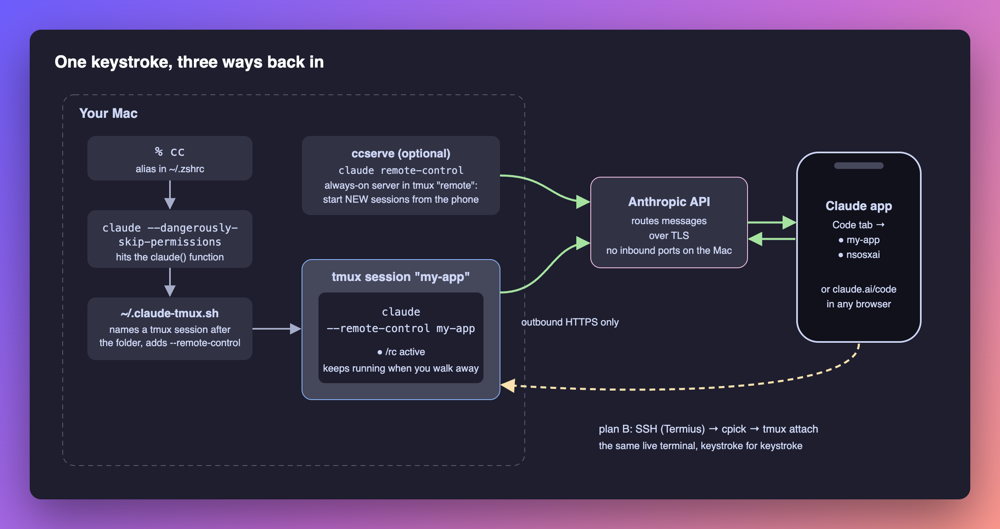

# claude-remote-control

Type `cc` on your Mac. Claude Code starts in a tmux session named after the folder, with
**Remote Control** on, so you can pick up the same session in the **Claude app** on your
phone, at **claude.ai/code**, or over **SSH**.



**Read the step-by-step guide, with screenshots: [ARTICLE.md](ARTICLE.md)**

## Let your AI set it up

Paste this into a terminal on your Mac:

```bash
claude "Set me up with https://github.com/YOLOVibeCode/claude-remote-control — follow the 'For AI agents' steps in its README."
```

Or paste the quoted sentence into any coding agent (Cursor, Codex, Copilot…).

### For AI agents

If a user pointed you here, do this, in order:

1. Check prerequisites. Run `claude --version` (install Claude Code if it's missing) and `tmux -V` (`brew install tmux` if it's missing). Remote Control needs a claude.ai subscription login, so warn the user if `ANTHROPIC_API_KEY` is set.
2. Clone the repo: `git clone https://github.com/YOLOVibeCode/claude-remote-control.git ~/claude-remote-control`
3. **Ask the user** whether `cc` should skip permission prompts (`./install.sh`) or keep them (`./install.sh --safe`). Explain that skipping prompts plus Remote Control lets their phone run commands on this Mac without asking.
4. Run the installer they chose from inside the clone. It backs up `~/.claude-tmux.sh` and never duplicates lines in `~/.zshrc`.
5. Verify with `bash tests/run.sh`. It should end with `0 failed`.
6. Tell the user to open a **new** terminal, `cd` into a project, type `cc`, and then open the Claude app → **Code** to find the session named after that folder.

## Install

Requires macOS (or Linux), [Claude Code](https://code.claude.com/docs/en/setup) signed in with
a Pro, Max, Team or Enterprise plan, and `tmux` (`brew install tmux`).

```bash
git clone https://github.com/YOLOVibeCode/claude-remote-control.git
cd claude-remote-control
./install.sh            # cc = claude --dangerously-skip-permissions
./install.sh --safe     # cc = plain claude, permission prompts kept
./install.sh --uninstall
```

Open a new terminal, `cd` into a project and type `cc`.

## What's inside

| File | What it does |
| --- | --- |
| [`shell/claude-tmux.sh`](shell/claude-tmux.sh) | A `claude()` wrapper that runs interactive sessions in tmux with `--remote-control <folder>`. Also `cpick` (a session menu on SSH login) and `ccserve` (an always-on `claude remote-control` server, so the app can start new sessions) |
| [`shell/tmux.conf`](shell/tmux.conf) | Six tmux settings: mouse, scrollback, fast Esc, tab titles, and drag-to-copy into the macOS clipboard |
| [`install.sh`](install.sh) | Idempotent installer with backups, `--safe`, `--supervise` and `--uninstall` |
| [`claude_rc/`](claude_rc/), [`bin/claude-rc`](bin/claude-rc) | Pins each tmux session to its conversation, restarts dead ones, alerts and reports (see Supervision) |
| [`launchd/`](launchd/) | Templates for the 10-minute watchdog and the daily report |
| [`tests/`](tests/) | `run.sh`: wrapper and installer tests (bash + zsh, stub `claude`/`tmux`), then the Python suite |
| [`tools/screenshots/`](tools/screenshots/) | How the terminal screenshots were captured, with IDs masked |

## Commands

| Command | Effect |
| --- | --- |
| `cc` / `ccc` | New session or continue the last one. Runs in tmux with Remote Control on |
| `/remote-control` | Inside a session: show the URL and QR code, or reconnect |
| `ccserve` | Start the Remote Control server in tmux session `remote` (`ccserve restart`) |
| `cpick` | Pick a tmux session to attach to (runs on its own at SSH login; `NOMENU=1` skips it) |

## Supervision: survive outages and reboots

A restart that only knows a session's *name* opens a blank conversation. `claude-rc` pins every
tmux session to its conversation id and brings it back with `--resume <id>`, so a crash or a
reboot returns the same chat, in the same folder, under the same Remote Control name.

```bash
./install.sh --supervise        # installs claude-rc, schedules the watchdog + daily report, adopts running sessions
```

| Command | Effect |
| --- | --- |
| `claude-rc adopt` | Record every running tmux session in `~/.config/claude-rc/sessions.json` (never overwrites an entry) |
| `claude-rc check` | Each pinned session's state; exit 1 if any needs you (`--json` for scripts) |
| `claude-rc watch` | What launchd runs every 10 min and at login: restart, relink, alert on changes |
| `claude-rc up [name]` | Start pinned sessions that are down, by hand |
| `claude-rc report` | Email the all-clear now |
| `claude-rc notify-test alerts\|report` | Send one test message through the configured provider |

New sessions are pinned at birth: the `claude()` wrapper passes `--session-id <uuid>` and records
it. Each manifest line holds `name`, `dir`, `conversation`, `flags` (reused on restart; seeded as
`--dangerously-skip-permissions`) and `enabled` (set `false` to leave a session alone).

**States.** `PARKED` stopped on purpose (see below): never restarted. `OK` alive on its conversation and linked. `DEAD` no tmux session: restarted (3 an
hour at most, then `GAVE_UP`). `UNLINKED` Remote Control dropped: when the session is idle for
two runs, `/remote-control` is typed into it; if the link is still off, it is typed again every hour, up to
6 times, so a session that dropped during a network outage comes back after it (`UNLINKED_STUCK` from the first
failed try, alerted once).
`WRONG_CONVERSATION` and `NOT_RUNNING` are reported and never touched. `UNTRUSTED`: a dead
session whose folder Claude Code does not trust is not restarted, because claude would stop at
the trust prompt; open claude in that folder once and accept (your home folder cannot be
trusted, so keep supervised sessions in project folders). `check` and the report flag these. `RESTART_FAILED` means a
restart never registered; the pane's last lines go to `~/.config/claude-rc/watch.log`.

**Alerts and the daily report** go through pluggable providers, chosen per channel in
`~/.config/claude-rc/config.json` (copy [`config.example.json`](config.example.json)):

| Provider | Alerts (SMS) | Report (email) |
| --- | --- | --- |
| `noctusoft-relay` | ✓ | ✓ |
| `twilio` | ✓ | |
| `smtp` (any mailbox) | | ✓ |
| `sendgrid` | | ✓ |
| `console` (dry run) | ✓ | ✓ |

`env` in the config names environment variables; their values live in
`~/.config/claude-rc/secrets.env` (chmod 600), for example filled from 1Password without printing:

```bash
printf 'NOCTUSOFT_API_KEY=%s\n' "$(op read 'op://<vault>/<item-id>/credential')" > ~/.config/claude-rc/secrets.env
chmod 600 ~/.config/claude-rc/secrets.env
claude-rc notify-test alerts
```

One SMS when a session newly needs you, never one per run; restarts that worked and recoveries
go to `watch.log` and the daily report instead. Undelivered alerts are retried next run. Adding a vendor is one class in `claude_rc/notify/` plus one line in its
registry; `tests/test_providers.py` checks it against the same contract as the others.

**Outside heartbeat (dead-man switch).** Nothing on this Mac can report the Mac itself being
down (asleep, powered off, at the FileVault screen, offline). With a `heartbeat` section in
`config.json`, every watch run POSTs `{source, host, ok, total, needs_you}` to an always-on
service, which texts you once when beats stop and once when they resume. The reference
receiver is `POST /v1/heartbeat` in [cloud-agents](https://github.com/rvegajr/cloud-agents)
(`HEARTBEAT_TOKEN`, separate from any token that can do more). A failed beat is logged and never
stops the watchdog.

**Reboots.** launchd user agents start at login. With FileVault on, a reboot waits for someone to
log in; for unattended reboots, turn on automatic login (System Settings → Users & Groups) only if
that trade-off is acceptable for this Mac.

## Day, night and the door: stay reachable without hogging the Mac

By default the watchdog keeps every pinned session running forever. Each idle Claude Code
session holds 250-600 MB and wakes the CPU about ten times a second, so thirty of them
cost gigabytes for chats nobody is using. A `policy` and a `door` in `config.json` change
that. Both are off until you turn them on, and `claude-rc plan` shows what they would do
first.

| | Day (06:00-24:00) | Night (00:00-06:00) |
| --- | --- | --- |
| A session idle this long is **parked** | 8 hours | 30 minutes |
| Most sessions running | 8 (least recently used parked first; never one used in the last hour) | same |
| Still running | busy or waiting sessions, `keep` sessions, recent work | the door, `keep` sessions, anything used in the last 30 minutes, all at background priority |
| After a crash | restarted if it was in use | restarted only if it was in use in the last 30 minutes |

**Parked** means stopped on purpose, losing nothing: `/exit` is typed only when the session is
idle, its input box is empty, the pane is not in copy mode, and claude is the pane's own
process. If `/exit` does not end it within 30 seconds and it is still idle, its tmux session is
closed. A parked session is never restarted and never alerts. `claude-rc unpark NAME` brings
back the same conversation.

**The door** is one always-on `claude remote-control` server (the same thing `ccserve` runs),
supervised by the watchdog. From the Claude app you can always start a session on this Mac, or
ask the door to run `claude-rc unpark NAME`. It runs with `--permission-mode acceptEdits`, so
edits go through but commands ask on your phone. At night it drops to background priority.

| Command | Effect |
| --- | --- |
| `claude-rc plan [--at HOUR] [--json]` | What a watch run would do with the policy on, and why a park would be blocked. Changes nothing |
| `claude-rc park NAME...` | Stop a session on purpose; it stays parked |
| `claude-rc unpark NAME...` / `--all` | Start parked sessions again on the same conversation |
| `claude-rc keep NAME...` / `auto NAME...` | `keep`: always running, never parked. `auto` (default): parked when idle |

**Turning it on.** Run `claude-rc plan` and `claude-rc plan --at 1`, then `claude-rc keep` the
sessions that must always run (a dev server, for example). Clear anything listed as blocked
(press `q` in a pane in copy mode; send or delete a draft). Then set `"policy": {"enabled":
true}` and `"door": {"enabled": true}` in `config.json` (see
[`config.example.json`](config.example.json) for every setting). A first week with
`"idle_park_hours": 72` and `"max_live": 30` is a gentle start. To undo, set `enabled` back to
`false`: the next run restores normal priority, and `claude-rc unpark --all` brings everything
back.

**When delivery fails.** If alerts, the heartbeat or the report fail 3 runs in a row, the
watchdog shows a macOS notification once, lists the channel in the daily report and in
`claude-rc check`, and logs when it recovers.

## Safety

`--dangerously-skip-permissions` plus Remote Control means a device signed in to your Claude
account can run commands on your Mac without a prompt. Turn on **Require trusted devices** in
claude.ai settings, only trust project folders, and keep secrets out of prompts and command
lines. Or install with `--safe`. More in [ARTICLE.md → Safety](ARTICLE.md#safety-read-this-before-you-copy-the-alias).

## Test

```bash
bash tests/run.sh
```

MIT licensed.
